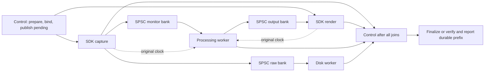

# Native monitored recording owner

2026-10-11. M2. Full-suite scope, Linux/Windows delivery, installation and European
localization remain active and incomplete.

## Coded workflow

`NativeMonitorRecording` owns prepared native endpoints, the admitted route,
original recording writer and separate processing/disk workers. The genuine
Windows adapter wraps the existing WASAPI capture/render streams. It uses the
existing signed system audio drivers and QPC conversion helper; no driver,
virtual cable or dependency is added by this layer.

Construction derives original format/identity from the actual prepared
descriptors, checks raw layout/packet sequence, binds callback contexts and
publishes pending native/raw state before activation. The owner defaults to a
131,072-frame input ring so the existing 2,048-frame capture copy bound and all
32 monitor slots/postroll fit; explicit caller geometry remains authoritative.
The underlying prepared-route default and production queue capacities are unchanged.

Activation starts disk/processing owners, then render and capture. Every partial
construction/start failure stops and joins native owners before borrowed storage
retires. Control Stop requests carry an explicit opaque monitor end and receive
original processing receipts; admission does not imply successful Stop. Later
requests are refused after the processing owner exits. Cancel sends atomic intent
and SDK notifications. Normal completion drains; forced cleanup joins native and
processing owners, closes the raw producer even if its SDK callback was missing,
then joins disk and settles the group. Missing native ends remain OwnerLost.

Native callbacks and bounded processing contain no disk/GUI work. Scheduling
waits are outside those methods. Current QPC is sampled after acquiring clock
readings, so concurrently published readings are not compared against a cached
earlier time. Failed clock acquisition passes an explicit missing-time condition;
no device/steady/project timestamp is substituted.

The processing owner now publishes a fixed lock-free count of source frames
actually copied and released. It includes subsequently discarded startup history
and does not identify audible, output or project frames. Progress reads use
atomic receipts rather than another owner's mutable statistics. Independent
counters do not constitute a coherent global snapshot or reclamation permission.

After joins, finalization copies original native ends, processing/clock/buffer
faults and first activation/disk/storage errors. Failed writes retain queued raw
data and use inactive durable-common-prefix verification after releasing the job
lease. An empty cancellation reports its verified zero-frame prefix; it does not
attempt to finalize an empty take or manufacture a storage error. Successful raw
data alone cannot certify completed native monitoring.

## Acceptance and corrections

The existing native-startup suite retains its previous cases and adds five owned
recordings: mono48, explicit mono44.1→stereo48, stereo96→48, an actual simulated
failed capture Stop, and stereo48 with the 2,048-frame declared copy bound. Real
processing and disk workers run. One simulated SDK service thread serializes its
capture/render roles; production WASAPI owns two SDK threads. Original RF64 samples
are independently reopened and compared bit-for-bit, including headroom above
unity. Native/raw state is reopened under the existing inactive lease rules.

Additional workflows cover bind and nine partial activation stages, ordinary
prepared/active cancellation, missing capture/render ends, disk/clock failures,
raw metadata refusal, resource admission/release and repeated closure. An unread
64-entry control-reply queue deliberately pauses processing while capture remains
independent: the unchanged 32-slot monitor queue reports actual QueueFull/partial
delivery, and every accepted raw sample is retained and verified.

Initial fixtures overfed a ten-millisecond packet every 100 microseconds and
correctly faulted. Their source, logs and native/raw journals remain retained.
Matching the declared packet cadence fixed the simulation, and the independent
pressure workflow continues to require the real fault. Stronger cancellation
acceptance found the empty-finalization bug; the owner correction preserves the
original writer's non-empty-finalization rule. Under TSan, startup conversion
also exceeded the free-running fake queue window. Controlled virtual-device
cases now wait for bounded copied/released receipts; this qualifies ownership
under instrumentation and does not claim physical deadline performance. Original
manual 20-take/five-second/native cohort and production capacities are unchanged.

| Profile | Expanded startup/owner suite | New owned / total composed checks |
| --- | --- | --- |
| Release | Pass, 12.57 s | 955,963 / 5,562,498 |
| ASan/UBSan | Pass, 19.25 s | 959,810 / 5,566,345 |
| TSan | Pass, 22.78 s | 964,028 / 5,570,563 |
| MinGW | Seven current objects, warnings zero | Includes genuine SDK adapter; no native link/runtime claim |

The [qualification packet](../tests/results/M2/2026-10-11-native-monitor-recording-owner/manifest.json)
binds implementation `d9ffc04e45f280301ff3d42cd999077138311b4c`, 643 exact inputs,
generated commands/configurations, hashes and original failure evidence. Each
Linux profile recompiles thirteen objects, including the entire processing archive
affected by the new receipt/layout, and the new recording-owner archive. Unchanged
qualified archives are read-only; their hashes and source equivalence are checked.
Earlier qualified binaries/directories remain intact. Only source/log/command/hash
assets are included, with no executable/object/archive/audio assets uploaded.

## Preceding Windows qualification

[PR146](https://github.com/rhamenator/soundcurrent-daw/pull/146), run38177748593,
passed all four required jobs at head`a587b37bcf5e4aaf7495488e07477d1f18331745`,
tested merge`b06b6bc669e26aaa16e95547c5a871a49be00954`. Native execution passed all
71 suites, seven owned routes/1,016,991 new checks, 4,606,535 total composed checks
with guarded allocation/free/lock zero, and three actual original standalone
completions. The [original runtime packet](../tests/results/M2/2026-10-11-owned-native-monitor-route-windows-runtime/manifest.json)
retains all four byte-exact job logs, 308 changed-blob bindings and seven selected
artifact logs. The original 34,310,544-byte artifact SHA256 is
`7a75b603603d171d9d3d30244e8215365d31bed0a1cd94783b3039ea1b129a3d`.
It predates this new recording owner. Its SDK operations are simulated; it does
not resolve the older intermittent manual-writer delay or admit an ordinary merge.

## Remaining gates and next task

The genuine adapter needs its own native Windows link/runtime CI and physical
endpoint qualification. Worker scheduling, cold startup, latency/recording
alignment, device loss and larger FIFO geometry remain hardware/workflow gates.
The current cold clock-fit path waits for its existing two-second observation
span; this is not a low-latency monitoring parity claim.

Next: integrate the prepared in-process monitoring EQ, parameter ingress and
latency/state contract into the converted/mapped output while preserving raw
captures. Connect the owned Windows run to the reviewed desktop/controller
workflow, retaining explicit device selection and failure/recovery results. The
desktop factory remains disabled until those gates pass. Multitrack/MIDI and full
M2–M11, F/Q/C/N, imports, equipment profiles and localization completion remain open.
