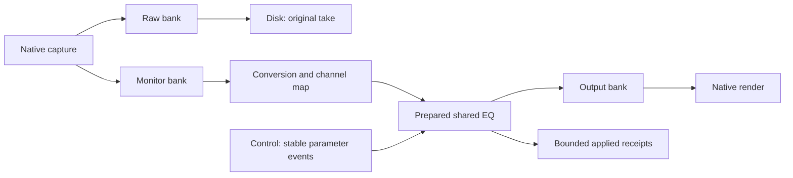

# Prepared EQ in the native monitoring route

2026-10-11. M2, original source `b99164d9746d9e60cc00e3c30986a5a02d72dc6f`.
Full-suite M2–M11, F/Q/C/N, Linux/Windows, European localization, imports and
profiles remain active and incomplete. This checkpoint enables no desktop factory
or physical endpoint and publishes no installer or release.

## Workflow and ownership

The owned native recording route now accepts an optional initial `MonitorEqSpec`.
It processes the converted and explicitly mapped monitor signal through the
existing in-process `PreparedEq`/`EqLiveDriver`. Raw capture is independent and
retains its original samples, rate, width and native stamp evidence. The shared
engine continues to serve live and offline workflows; no new DSP library or
algorithm is introduced.

Control prepares immutable settings, stable track/processor/band identifiers,
filter histories, planar scratch and bounded event queues before activation.
The aggregate resource admission charges DSP, scratch and all retained settings
copies before allocation. One processing owner runs the EQ after conversion and
mapping. Output backpressure retains the already processed block; publication
retry does not run the same block through the filters twice.

Scheduled events use a local monitor frame domain. Local frame zero corresponds
to the first opaque monitor ordinal, including origins above signed 64-bit range;
this does not establish raw/project/native alignment. Immediate changes use the
existing 128-entry revision queue and applied acknowledgements. Capacity and
foreign-generation failures are explicit and do not overwrite pending events.
The owner refuses new requests after closure or processing completion.

Internal floating-point headroom is preserved. Algorithmic EQ latency is zero;
its IIR tail is until-silent. An explicitly finite monitor end crops that tail.
There is no invented finite decay or claim that this alone establishes hardware
latency or plugin delay compensation. EQ faults are retained in terminal reports;
invalid/sanitized input or numerical failure does not certify a healthy pipeline.

## Initial declaration and recovery

Auxiliary native state defaults to 1.3. An optional `monitor-eq.bin` is published
exclusively and flushed before the pending native journal. Its canonical `SCMONEQ1`
format has version 1.0, output rate/width, enabled state, smoothing, stable IDs and
0–64 frequency/gain/Q bands. Its exact size is `112 + 60 * bands`, at most 3,952
bytes. The journal references its fixed filename, version, size and SHA-256;
the startup receipt binds the same declaration to actual output geometry.

Reopen uses bounded owned-file reads, strict fields/length/version/UUID/geometry
validation and EOF verification. The existing 16 KiB/depth 12/event 4,096/key 1,024
native journal limits remain intact; no EQ arrays are added to that journal.
Raw and ordinary project schemas are unchanged. Legacy native 1.0–1.2 remain
readable; writing a declared EQ into them is refused before creating the raw job.
Explicit 1.2→1.3 migration preserves absent EQ and original outcomes, is idempotent
and cannot downgrade state.

This artifact records the **initial monitoring declaration**. It does not persist
live parameter history, print correction into raw takes/default exports or replace
project automation. Those application workflows remain open.

## Acceptance evidence

[Local qualification packet](../tests/results/M2/2026-10-11-native-monitor-eq/summary.json)
retains exact bindings for 647 source/checkout inputs, generated build commands,
18 current objects per Linux profile, three private current archives, read-only
qualified archive hashes, executable hashes and full test logs. No object,
archive, executable or audio payload is included in the repository packet.

Two expanded existing suites pass:

| Profile | Total elapsed | Result |
| --- | ---: | --- |
| Release | 15.38 s | 2/2 suites pass |
| ASan/UBSan | 40.35 s | 2/2 suites pass |
| TSan | 29.31 s | 2/2 suites pass |

The new 63,863 EQ checks per profile cover canonical 0/1/64-band declarations,
mutations, stable IDs, 44.1/48/96 kHz and 1/2/8 channels, scheduled smoothing,
immediate enable/bypass, revision capacity and ordinal refusal. Monitor PCM is
bit-for-bit equal to independently exercised existing planar shared-engine PCM.
The owned recording suite has six recordings: the existing five plus mapped
mono48→stereo48 with EQ. Prequeued +12 dB revision applies at local frame zero;
output responds, applied receipt is observed and independently reopened raw RF64
bits remain identical. The persisted initial declaration stays separate.

Native state tests cover EQ reference/artifact mutations, legacy refusal before
job creation, migration, initial receipt binding and two actual process
interruptions at EQ publication/pending publication, alongside the original
native/migration/matrix boundaries. Guarded allocate/free/lock violations are zero.
Initial development link-helper and test compilation failures are retained with
corrections; they are not hidden by a later successful run.

Thirteen current Windows objects compile warning-free with strict conversion
warnings, including the genuine WASAPI adapter, high-resolution wait code,
state codec and both expanded fixtures. This is compilation evidence only;
current native Windows link/runtime qualification and physical audio remain open.

## Previous Windows failure and wait correction

[PR147](https://github.com/rhamenator/soundcurrent-daw/pull/147), exact head
`fe71f241fa715f7823e86e921e7fa7f812adcb0f`, run `38182908717`, failed its native job.
The other three jobs passed. Of 71 original CTests, 70 passed and native startup
failed: its first owned mono48 recording timed out at the unchanged five-second
wait with 65,280 raw frames, below the existing two-second moving-clock span.

A separate original standalone sequence completed twice and failed its third run
at take 2/identity 3/group-wait. The worker was observed at `AudioFlushBegin`,
written 2,304/committed 2,048; observed backlog was empty and no write was in flight.
The cause of that flush stall remains unresolved. This new EQ/wait work does not
modify the original manual worker or its deadline/cohort and does not establish a
fix for that failure.

[Failure packet](../tests/results/M2/2026-10-11-native-recording-owner-ci-failure/summary.json)
retains all four original job logs byte-for-byte in lossless compression, eight
selected original artifact logs, exact 444 changed blob bindings/tested merge and
artifact size/hash. The artifact ZIP and its binary/audio contents remain local.
PR147 remains draft and is not admitted through the failed required gate.

Windows ordinary short sleeps can exceed requested intervals. This is a plausible
contributor to native-owner cadence, not a causal conclusion from the old log.
The native recording processing/disk workers now prepare private high-resolution
waitable timers on control and request 100 μs waits outside audio callbacks.
Linux retains its existing sleep. No process-wide timer resolution change or
busy spin is introduced. The [Windows API documentation](https://learn.microsoft.com/en-us/windows/win32/api/synchapi/nf-synchapi-createwaitabletimerexw)
identifies high-resolution flag `0x2` and Windows 10 1803+ support. Actual wait calls
and maximum observed local spans are copied only after joins. Wait errors retain
original OS codes and cancel/fail safely. Requested waits are not deadlines.
A fresh Windows execution must assess cadence and both unchanged original gates.

## Equalizer reuse review

The equalizer workspace was read without changes at
`a3d770d3abf5f4c4e36c7681bc04234053a599c9`.
The borrowed biquad recurrence is byte-identical to the existing immutable GPL
adaptation revision `65151a8fec1aa4b4e6c283e4514d7f3d9166fe2b`; exact source and
recurrence hashes are retained. New upstream wrapper/enhancer changes were not
implicitly adopted. Existing notices and provenance remain authoritative.
The DAW adapter, bounded state and ingress can be evaluated for later upstream use.

## Concrete next task

Qualify current native Windows execution while retaining every original failure.
Then connect the owned route and EQ ingress to a finite desktop recording
controller: device selection, control acknowledgements, Stop/cancel, durable
recovery and reopen/export review. Gate physical scheduling/latency/alignment and
installed Linux/Windows workflows independently before enabling the factory.
The native streams/worker owner and monitoring EQ are already coded; no additional
placeholder preparation layer is needed. Full professional parity remains open.
