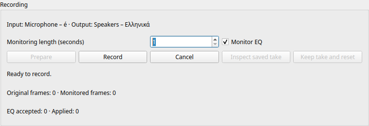

# Visible native recording panel

2026-10-11. M2. Full professional-suite scope remains active and incomplete.

## Implemented workflow

`NativeMonitorPanel` is a reusable Qt widget backed by the existing owned recording
controller. It presents selected input/output context, monitoring duration,
Prepare, Record, Cancel, monitor EQ, saved-take inspection, reset and progress.
The existing inspector can forward stable parameter/settings changes through its
`parameter` seam; coefficients and native commands are prepared on the worker.
The widget performs no SDK enumeration or recording-file I/O.

The screenshot is a real local widget at 760 × 260 pixels using simulated devices.
The selected context is supplied by the caller's device-inventory worker. This
checkpoint does not install a new default recorder or connect device dropdowns and
project transport in StudioWindow. The existing installed recording UI remains.

Prepare publishes native pending state on the worker before becoming Ready.
Record requests a finite opaque monitoring range using the actual admitted output
rate. Its duration is **monitoring duration**, not an inferred project or original
raw take length; clock-fit warmup and raw alignment remain distinct. Cancel keeps
the verified original outcome/prefix. Inspect independently reopens saved state.
Keep/reset releases the controller's exact result sequence while leaving media
on disk. Original raw data is not automatically attached as an aligned Asset.

The EQ checkbox is connected to bounded worker commands and applied receipts.
Acceptance verifies its effect on real processed monitor buffers. Bypass uses the
existing smoothing transition; its final buffer approaches the original signal,
while its whole-run peak includes the transition. Internal float headroom remains
unchanged.

Window close requests asynchronous worker shutdown and remains open until Closed.
The worker joins native/processing/disk owners and retains the result before the
widget closes. Container owners must request close and wait for `closeReady()`
before destruction; arbitrary deletion of an active worker can still block in its
joining destructor. Lifecycle integration with StudioWindow remains next.

## Resource and localization boundaries

Fixed control storage has a conservative admitted allowance. Selected context
and the temporary Prepare copy reserve panel payload credit before copying, using
the same bounded payload preflight as the controller. Refused context replacement
preserves the old selection. Command FIFO/in-flight credit remains separate.
These are payload allowances, not exact allocator/RSS accounting. Permanent device
models and immutable controller snapshot/result retention still require their
separate GUI ownership qualification before product integration.

Primary controls/status/progress text use Qt translation contexts. Numeric
readouts currently use Qt string formatting; locale-specific number formatting
remains to be qualified. Original backend details remain in a bounded plain text
tooltip. The Linguist update adds the new source messages: 34 catalogs,
946 keys, 3,135 draft translations and zero promoted native reviews/UI qualifications.
New non-English entries remain unfinished. All-European delivered coverage remains
open; catalog/refusal audits pass.

## Acceptance and retained failures

[Qualification packet](../tests/results/M2/2026-10-11-native-recording-panel/summary.json)
binds 784 source/checkout inputs. Five current objects per profile compile from
actual generated commands: panel, controller, widget fixture/audit and expanded
native recording fixture. Two private current UI/controller archives link against
unchanged qualified engine/native archives and test objects, verified read-only.
Full commands, configurations, logs and object/archive/executable hashes are
retained; binaries and audio are excluded. The packet includes the original UI
screenshot and failed observations.

Release passes both suites in 20.59 s; ASan/UBSan passes in 28.96 s. The existing
native-startup suite remains intact and uses a shared extraction of its proven
FakeStreams/Spy/RT/sample implementation. The only new measurement is a joined
last-output-buffer peak; no virtual endpoint pacing/deadline changes are made.
Real controller/processing/disk workers drive the visible widget.

The panel fixture checks preparation off GUI, no premature activation, immutable
context/quota refusal, a one-second finite monitor run, actual smoothed EQ bypass,
original completion/applied receipt, saved-state/raw hash inspection, unchanged
saved project, retained media after reset, and asynchronous close during recording.
All owned SDK callbacks join; guarded allocations/frees/locks remain zero.

The first UI observation failure is retained. The test clicked unused space in an
expanded checkbox rectangle; it now clicks the visible indicator. The next failure
expected the whole-run bypass peak to equal raw peak, overlooking the existing
smoothing transition. The corrected test independently observes the final buffer
and retains the transition peak. Original source/commands/logs are preserved.

Four current SDK/controller/core fixture objects compile warning-free for Windows.
Current Windows GUI compilation/execution is required by the fresh desktop CI
job, which retains the original 19 tests and adds the panel test. No physical audio
or installed preview qualification is claimed.

### GUI TSan remains unqualified

The native-startup suite passes TSan in 28.58 s. The widget's functional assertions
also complete, but its process reports 22 race/thread-leak warnings involving
system Qt Core/D-Bus and libdbus threads, including allocation interposition stacks.
Those library synchronization paths are not fully instrumented in this build.
The full original report is retained. The GUI TSan run is **not green**; no blanket
suppression, assumption of false positives or unchanged retry is used. Review
framework thread retirement and qualify with appropriate dependency instrumentation
before claiming the GUI thread-safety gate.

## Preceding admission candidate: actual Windows proof

[PR151](https://github.com/rhamenator/soundcurrent-daw/pull/151), exact head
`a849697ebfdbe202f6fa56d05bbd69ddae902c85`, tested merge
`37dcfc2262f34486a784e51ad0dbef5fc6f794be`, run `38193276855`, passes all four jobs.
The command-credit/copy-witness, controller/EQ and original 71 native suites execute
on Windows. Original 22 manual cases and three standalone diagnostics complete;
desktop 19/four interruption cases and Linux 143 pass. This predates the widget.

[Original runtime packet](../tests/results/M2/2026-10-11-command-admission-windows-runtime/summary.json)
retains all four original terminal logs, original artifact logs/JSON timing records,
exact 946 changed blob/780 qualified input bindings and original artifact metadata.
Its passing results do not resolve earlier watchdog/manual timeout/flush-stall
causes. No ordinary readiness or merge admission is performed here.

## Concrete next implementation

Connect the coded panel to StudioWindow's worker-owned device inventory, selected
track/inspector and shutdown lifecycle. Admit retained inventory/model/snapshot/
result payloads, expose explicit device selection and qualify framework thread
retirement. Then test current Windows UI/native execution and installed Linux/
Windows/hardware alignment/reopen/export workflows. Full M2–M11/F/Q/C/N/X004/X005/
platform/European-language parity remains active and incomplete.
