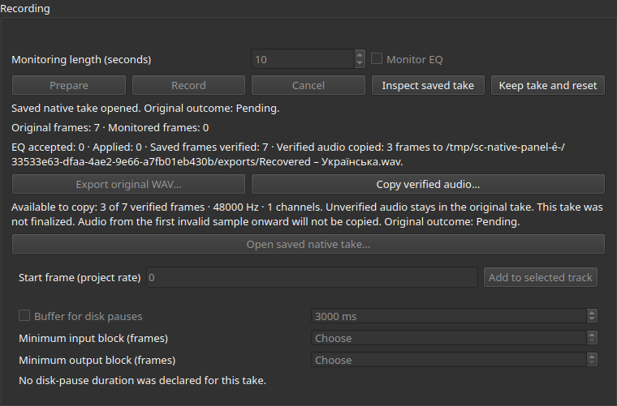

# Reviewing and copying recovered audio in the desktop

Checkpoint249 connects verified-prefix copying to both native desktop routes.
The locally built Linux application contains the controls; this checkpoint has
not replaced the installed preview. New-source Windows runtime and installers,
physical audio and the full suite remain independently incomplete.

## User workflow

Open a saved native take in its saved project. The recording panel displays its
original outcome and how many verified frames are available to copy, with native
rate/channel count. Unfinalized takes and a cut at the first invalid sample are
identified; unverified audio remains in the original. Choose **Copy verified audio…**
and select a new WAV destination. The receipt shows the actual copied frame count
and destination. The original take remains available for inspection.

**Export original WAV…** stays separate: it copies a finalized wholly finite
original container byte for byte. Prefix copying creates a new RF64 container
with exact copied sample bits. It does not EQ, normalize, infer alignment, attach
an asset, resume capture or change original completion status. A pending take
continues to display Pending after its playable prefix has been copied.

Competing actions are disabled immediately when a copy is queued. Cancel remains
available; closing requests cooperative cancellation and waits for the I/O owner.
A completed copy receipt remains available on later refusal. Wrapped destination
receipts reserve enough label height to remain readable at the tested width.

## Worker and ownership

The appended CopyPrefix command validates the exact retained result sequence,
inactive ownership, positive playable prefix and destination. The core now accepts
an optional explicit reviewed-checkpoint expectation: committed frames/packets,
finite extent, sample/stamp hashes and finalization. It compares the verified
checkpoint before creating output. A valid externally changed checkpoint cannot
silently become a different copy from the one reviewed.

Both existing native adapters are called on the serialized I/O worker. Its
atomic cancellation epoch/closing flag drives core cancellation. The optional
progress observer also runs on that I/O owner. No file probing/copying or SDK work
is performed by the widget or audio callbacks.

An admitted copy-receipt holder is allocated before I/O and published through an
aliased immutable shared pointer. Exact result release clears the view while an
external consumer retains the holder's own credit until its final release. Source
and copied files are not deleted by that action. Existing memory scopes are used:
the real PipeWire factory already has64 MiB, native standalone defaults16 MiB,
and StudioWindow shares the application's resource ledger. No global buffer or
quota increase is introduced. Original/native journal schemas remain unchanged.

## Acceptance

Code source `69d84d2e5ddae9bd29477baecb03c221c753f1ef`:

- Initial four Release workflows pass in16.68 s: typed PipeWire controller2.23,
  raw recording/checkpoint expectation0.11, localization0.67 and visible panel13.67.
- Visual inspection identified a clipped receipt in the first760×500 screenshot.
  The original screenshot/log remain retained. The wrapped-label fix rebuilt
  the application and passed panel/localization2/2 in14.15 s (13.45/0.70).
- Final panel build includes both adapters and passes13.49 s with181 checks.
  The final screenshot was inspected; destination and recovery preview are readable.

The visible native recovery test creates a real unfinalized Pending job with
7 committed frames and a3-frame finite prefix. A fresh controller with **no SDK
factory** opens it. Clicking the actual Qt button opens the actual Qt save dialog;
the test selects a Unicode path and accepts it. The test process forces the
non-native Qt picker, so Windows shell-picker integration is not claimed.

Copied frames/source bits, Pending outcome, disabled full-original export, visible
preview/receipt, unchanged project and original PCM/journals are verified. An
existing destination is refused without damaging the preceding copy. The test
then constructs and independently verifies a self-consistent changed checkpoint
with2 finite frames and a new matching sample hash; the reviewed3-frame copy is
refused before output publication.

A controlled real copy progress callback holds the I/O worker. The GUI remains
responsive and disables competing actions. Visible Cancel and asynchronous close
publish no partial destination, preserve original source/outcome and retain the
preceding successful receipt where applicable. Callback thread identity is checked
against the GUI thread. Exact source release and last-consumer credit retirement
are verified. Reopened PipeWire takes also expose the enabled copy control and
show the actual copy receipt with unchanged native disposition and sample hash.
Core stale-expectation and worker stale-result-sequence refusal are exercised.

The application entry point links successfully. The tests use local DISPLAY:1,
xcb and real Qt windows on this Ubuntu desktop. They use owned synthetic files
and simulated SDK routes; no VM, physical endpoint, volume/output-device change,
installed-preview replacement or new sanitizer claim is involved.

Real `tools/localization.py --update` was run after UI changes, including the
layout correction. The current inventory is1,021 keys across34 catalogs with3,168
existing draft translations and zero native-reviewed/fully-UI-qualified languages.
Extraction is not completed European language coverage or translation review.

The [evidence index](../tests/results/M2/2026-10-13-recovery-copy-desktop/index.json)
contains61 compressed text/configuration/metadata members,853 source-input bindings,
5 executable hashes and two actual screenshots. PCM, executables and original
CI ZIPs remain local.

## Independent preceding-source Windows evidence

[Original PR182 run](https://github.com/rhamenator/soundcurrent-daw/actions/runs/38352457444),
sourcee4181cd, passes all four jobs: Linux161/161 in462.52 s, Windows native88/88
in357.96 s, Windows desktop20/20 in64.50 s and core cross-build. Original APIs,
job logs, selected metadata and Windows archives are retained separately.
Its PowerShell test actually exercised a distinct Windows8.3 temp-parent alias,
and controller expiry/reserve gates passed. That source does not include this
new desktop-copy workflow. Historical PR180 failed-controller bytes remain absent
from its returned ZIP; later passing runs do not recreate or explain that case.

## Next concrete work

Retain the new-source original CI terminal result and qualify the desktop workflow
independently on Windows, including its controlled cancel/close cases. Prepare and
qualify updated installable previews without erasing known limits. Continue native
playback/installer checks when resources allow and the remaining recording/full-suite,
quality/content/import/profile and reviewed European localization milestones.
