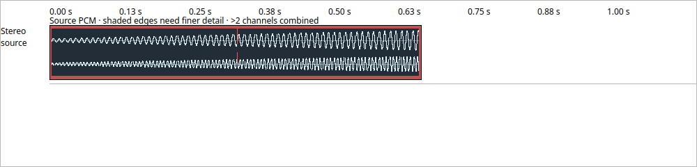

# Visible timeline source waveforms

Checkpoint 347 connects the verified waveform cache to the timeline. The desktop
passes project root and opening epoch through prepared model publication; a new
opening clears displayed authority immediately. The control timer collects only
visible source identities, schedules preparation, and publishes immutable data.
Painting performs no filesystem access, process launch, decode or audio work.
Once a view is ready or faulted, the timer skips further scans until view/model
changes. Playback and exported audio are unchanged.

## Display semantics

Audio rows with a project context have more vertical room for waveforms. Mono and
stereo channels have separate lanes. More than two channels use an explicitly
labelled min/max envelope across channels; this compact overview is not a
per-channel editing view. Source peaks outside [-1,1] are red. That indicates
floating-point source headroom, not a claim that processed output is clipping.
The header identifies source PCM rather than post-gain, fade, EQ or output audio.

The existing rational mapping places trimmed, rate-converted and playback-rate
clips. Only complete bins are drawn. Coarse partial edges are shaded rather than
using extrema belonging to excluded samples. Short sources retain sample detail;
large sources use a power-of-two base targeting at most 65,536 channel-bins.
Rendering selects a coarser level according to pixel/channel work. This gives a
useful bounded overview; fine window preparation and sample editing at arbitrary
zoom remain future work.

The cache admits up to 32 unique visible sources as one set. Excess sources or
resource refusal produce an unavailable notice, never a silently selected subset
or a previous project's waveform. The limit concerns this initial cache, not
project track capacity. The worker's existing 1 GiB source-file policy remains;
larger files need window preparation before waveform support can be qualified.
Faults do not automatically restart work. Reopening rechecks sources; live file
watching and an explicit retry/resolution control remain open.

## Ownership, close and packaging

Project context storage, display staging, cache and controller payload retain
shared-ledger credits. GUI retirement is outside the audio callback. Application
shutdown requests waveform cancellation and observes controller closure before
accepting the window close. The destructor join is a fallback, not the normal
close workflow. Failed GUI preparation retains the previous explicit view and
its existing application warning; no new-root peaks are painted into that view.

CMake builds and installs the real waveform worker beside the app. Linux staging
requires exact bytes and executable mode. Windows deployment collection includes
the worker, installer input validation requires it, and native main qualification
must bind its hash. The test-only lifecycle probe is not installed. No new runtime
dependency or project schema is introduced.

## Verification scope

The focused GUI fixture uses a real stereo floating-point WAVE and actual worker,
checks rendered peak/headroom colors, zoom reuse, project reopening, wrong-digest
refusal and asynchronous shutdown. It produces a screenshot for visual inspection.
Existing timeline selection and virtualized-view tests exercise surrounding
behavior. Package fixtures cover missing/stale worker rejection and extracted
Linux executable mode; Windows input tests reject a missing required helper.
See the [acceptance manifest](../tests/results/M2/2026-10-15-timeline-waveforms/manifest.json)
for final commands and results. The seven focused Release suites pass in 13.02
seconds; the actual GUI/worker fixture also passes ASan/UBSan with leak detection
in 1.67 seconds. The 8,192-track view paints one visible row without rebuilding indices
while scrolling. The original centre-pixel oracle failure is retained: the
updated assertion samples the preserved coloured edge outside waveform and
selection ink. The screenshot below was inspected from the actual GUI fixture.

Native Windows waveform drawing, installed previews, large-file/fine-edge support,
multichannel inspection, explicit recovery controls and complete waveform editing
remain unqualified. The frozen full-suite goal remains active. Installed previews
are unchanged until native and installed workflow gates pass.
