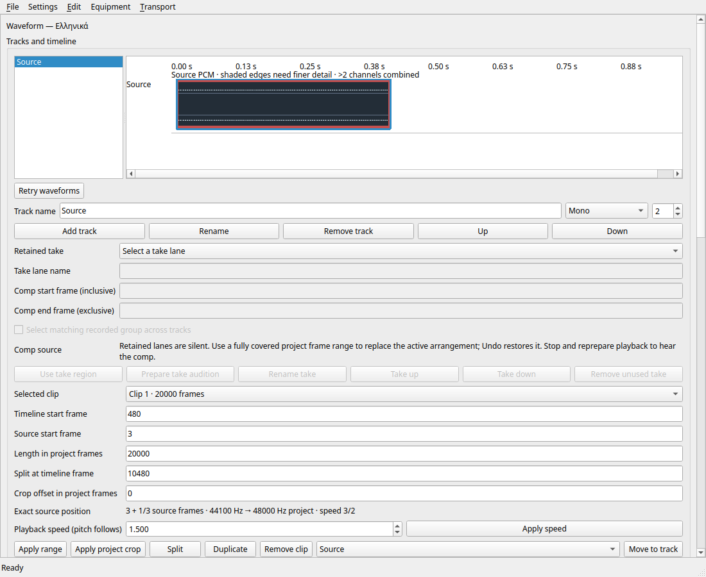

# Full-window waveform workflows and explicit retry

Checkpoint 348 adds **Retry waveforms** next to the timeline. It invalidates
previously prepared source peaks, cancels obsolete preparation and rechecks the
visible sources. It does not edit the project, touch Undo/Redo history, or activate
audio. Restoring a missing file and retrying can therefore recover the display
without reopening the project. Preparation/failure information is also exposed as
the timeline's accessible description. New strings remain untranslated where no
reviewed translation exists; this does not promote language support.

The full application fixture opens saved projects from a Unicode directory and
uses mono, stereo and discrete three-channel floating-point sources. A separate
constant-level pixel oracle checks channel placement and combined extrema at
44.1 kHz source / 48 kHz project rate, fractional offset and 3/2 playback rate.
It changes clip gain through the actual controls, verifies source PCM display
remains unchanged, exercises Undo/Redo, saves, reopens and checks normal async
window closure. It then removes/restores owned media and uses the retry button,
checking failure visibility, recovery and unchanged project revision/dirty state.
Simulated audio endpoint counters must remain inactive throughout.

## Native findings from the preceding revision

Original run `38811082886` at `da9d5b9` passed the native waveform cache suite
(112,881 checks), comp workflows and the instrumented crossfade workflow. Its
waveform controller suite stopped at the exact-CRLF diagnostic assertion. The
fault injector wrote a literal CRLF while leaving stderr in text mode. The Windows
CRT translates output LF to CRLF; binary mode suppresses that translation.
[Microsoft's `_setmode` documentation](https://learn.microsoft.com/en-us/cpp/c-runtime-library/reference/setmode?view=msvc-170).
The test helper now sets stderr to binary before writing exact bytes. The product
parser still accepts only its specified LF/CRLF diagnostics; it was not loosened.
Native confirmation of the corrected helper remains a separate gate.

The crossfade suite passed in 29.68 seconds. The original log places 28.85 seconds
between the font-resolution marker and fixture creation, followed by less than
a second of dialog work. Additional markers separate font creation from glyph
coverage. The suite budget is now 60 seconds to accommodate observed platform
startup; all UI assertions remain. This is not a cold-start performance
qualification and does not prove where the older uninstrumented timeout occurred.

The complete original run is preserved before PR advancement: 15 full job logs
and 11 original archives (1,860,318,677 bytes), with size/hash/CRC verification.
Eight focused Release suites pass in 19.09 seconds, including 81 full-window
checks, eight rendered-view checks, 106 controller checks and existing crossfade,
timeline, virtualization and catalog gates. The rendered-view retry test also
passes ASan/UBSan with leak detection in 1.91 seconds; the full-window workflow
was tested in Release. The screenshot run adds one save assertion. Its actual
window was visually inspected with the retry button visible beside the timeline.

See the [acceptance manifest](../tests/results/M2/2026-10-15-studio-waveforms/manifest.json)
for final commands, exact source binding and retained failures. The initial
fixture build's missing-Q_OBJECT lookup was repaired with the same dynamic-cast
lookup used by the existing window tests.

The constant levels in this fixture make channel ordinates independently testable.
 This checkpoint does not replace installed previews or qualify the new
waveform drawing/retry on Windows. Fine-window/large-file support, per-channel
multichannel inspection and the full DAW parity scope remain open.
