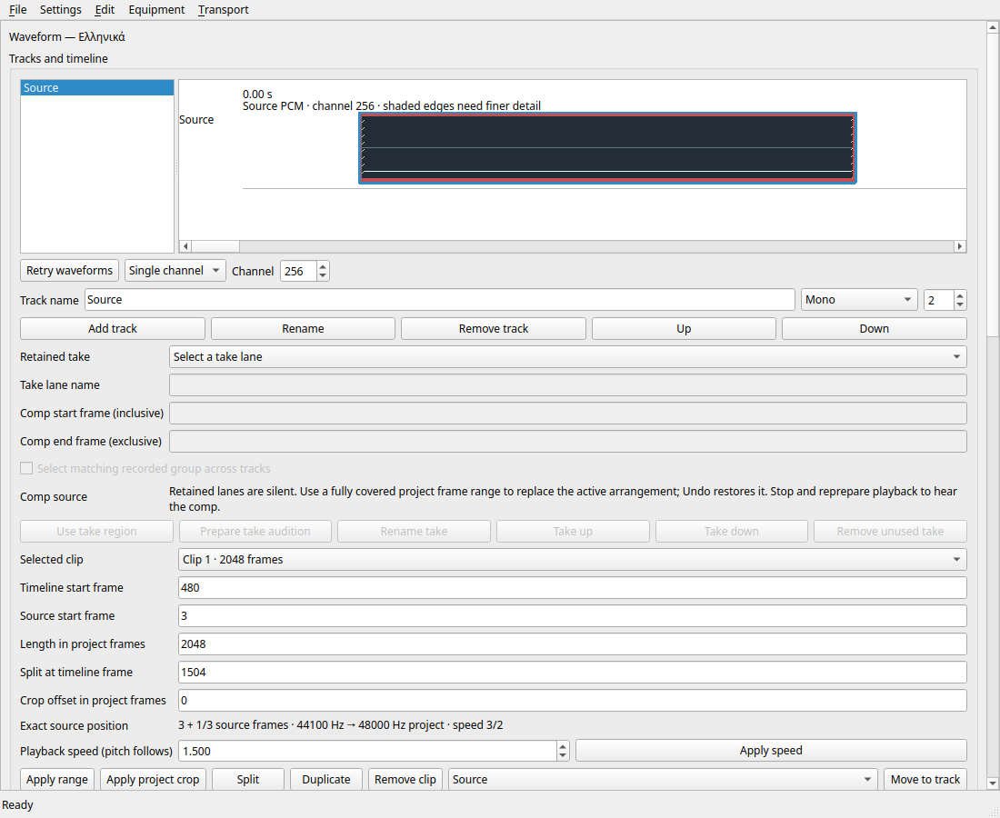

# Inspect individual source channels

Checkpoint 349 adds an **Overview / Single channel** selector directly below the
timeline. Overview retains separate mono/stereo lanes and the combined envelope
for larger layouts. Single channel displays the numbered source channel on each
visible clip. This is a window-local display preference: it changes neither
routing nor samples, project state, Undo history, or saved files.

The selector reuses the immutable prepared peaks. Switching channels does not
decode the media again or discard the cache. The painter reads only the selected
channel and retains the existing bounded bin-selection policy. Source values
outside ±1 remain red; these indicate source headroom, not processed-output
clipping. Shaded crop edges still require finer data.

Channel numbers are one-based in the UI and locale-formatted in status messages.
The selector accepts 1–1024, matching the source-reader policy; the current project
layout limit remains 256. A source without the selected channel shows **No channel
…**, with the absence also reported accessibly. It is not rendered as silent audio
or replaced with another channel. Invalid internal requests are rejected before
changing the selection. New strings are extracted by Qt Linguist; unfinished
translations remain fallback text, not qualified language coverage.

## Acceptance

The actual StudioWindow fixture now opens mono, stereo, three-channel and
256-channel saved projects in a Unicode directory. Synthetic constant levels give
an independent pixel/color oracle for channels 1, 2, 3, 255 and 256 as applicable.
Selection must retain prepared data and leave the model revision, dirty flag and
canonical session unchanged. Selecting absent channel 1024 must expose the
absence. The same fixture then exercises clip gain, Undo/Redo, save/reopen,
missing/restored media retry and normal asynchronous close. Simulated endpoint
counters remain inactive. No multichannel hardware is needed for these checks.

Eight focused Linux Release suites pass, including 164 full-window assertions,
10 rendered-view assertions, controller lifecycle, existing editing/virtualization,
and catalog validation. The rendered-view fixture also exercises valid and invalid
channel selection under ASan/UBSan. The separate screenshot run captures the
whole window with channel 256 selected at a closer zoom.

See the [acceptance manifest](../tests/results/M2/2026-10-15-waveform-channels/manifest.json)
for exact tested source, commands, logs and binary hashes.

## Remaining gates

This is source-waveform inspection, not 256-channel hardware qualification.
Native Windows validation of this selection workflow and refreshed installed
previews remain outstanding. CI run `38814953536` covers the preceding revision
`79aa56d`, including the waveform drawing/retry integration and Windows test-helper
repair; it does not cover this checkpoint. Preserve its original terminal evidence
before advancing the PR branch. Existing installed previews are unchanged.

Fine-window decoding, larger-file support, simultaneous per-channel lanes for
larger layouts, and the remaining M0–M11/X004/X005/localization requirements remain
open. This checkpoint does not establish full DAW parity.
