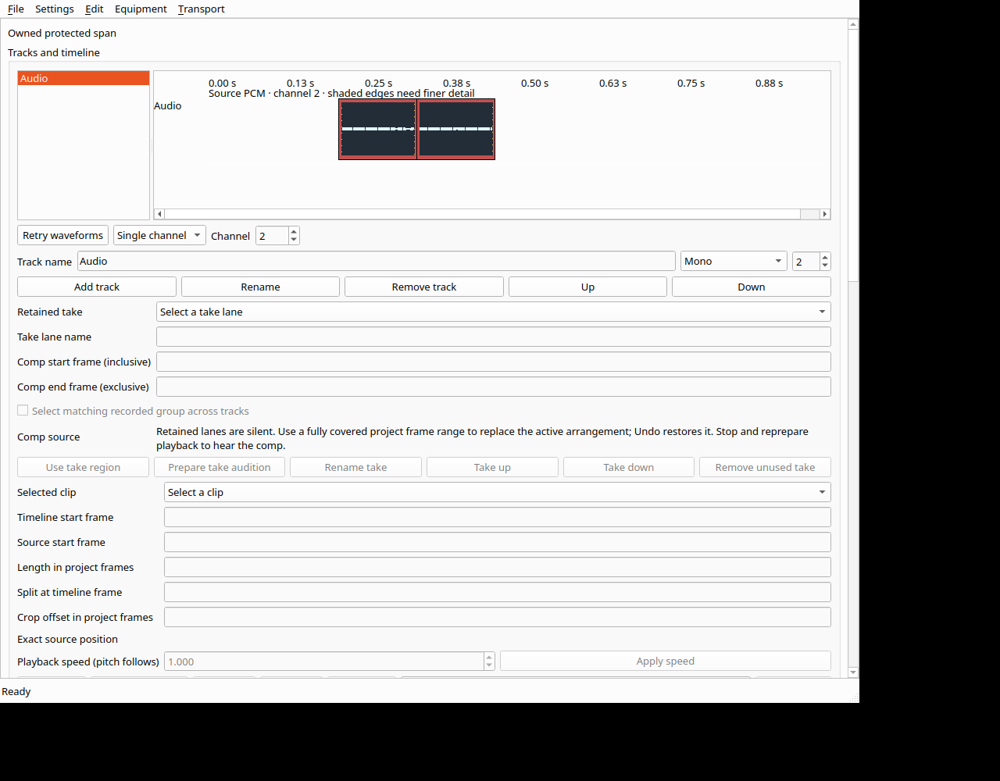

# Installed Linux preview with source waveforms

Checkpoint 351 activates Ubuntu preview
`0.1.0~preview.20261015223130.f2f9f7c8916e` from source
`f2f9f7c8916e34582db9f289f62bda2019d1c330`.
**SoundCurrent DAW Preview** in Applications now opens this version.
**SoundCurrent DAW Preview (before source waveforms)** opens the preserved
`97e9ecd` preview. Existing other launchers remain unchanged.

The preview includes source waveforms, individual-channel inspection, explicit
missing-channel feedback, and Retry waveforms. These displays show source PCM;
they do not measure processed output or alter audio/routing. Fine-window and
large-file work remains open, as described in checkpoints 347–349.

## Build and package

The Linux packaging gate now requires the waveform helper's exact hash in the
test receipt, in addition to verifying installed bytes and executable mode.
Missing/stale receipts and a helper changed after testing are rejected.

The cached Release build uses one compiler worker. All **31 selected preview
tests pass in 177.55 seconds**, including the four waveform suites and the prior
recording, comp/editing, worker, project, export, localization and package gates.
Source and executable hashes remain unchanged throughout those checks.

The DEB is **7,160,396 bytes**; every extracted payload matches its prepared
payload. The matching source archive is **2,540,199,270 bytes**. All **8,167 tracked
files** match the frozen commit or its declared Git text filters, with complete
membership, SHA-256 and gzip CRC checked. Packages remain local; no binary release
is published. This is a per-user preview installation, not a clean-machine or
system-package installation qualification.

## Actual installed workflows

Testing uses a private display/session bus and a private PipeWire daemon exposing
only Dummy/Freewheel nodes. No VM or physical audio route is used.

Through public application controls, the installed app:

- Displays source channel 2 and explicitly identifies absent channel 1024.
- Reports unavailable waveforms after owned source media is moved aside, then
  recovers after restoration and Retry. The source hash and project values remain
  unchanged; Undo availability is unchanged.
- Changes playback speed, renders extended transition handles, reviews and applies
  them, saves, undoes, redoes, and saves again.
- Reopens the exact saved state, exports WAV and quits normally.
- Opens the same candidate and project through the Applications entry and quits.

The transition's observed render time is 4,304 ms. This is one workflow observation,
not a performance benchmark. The 48 kHz stereo float export contains 18,032 frames
and matches the independent gain/fade/mix calculation **bit for bit**, maximum
error zero. Its SHA-256 remains
`70a071120e26b4aa4a2b5cdd4a220d0932c604d5ad926ac9834067201894af6b`.
Original fixture media, all 20 installed payload files and the previous preview
remain unchanged. The test applications and private audio services retire.

## Test-observer corrections

The initial save assertion compared raw JSON bytes. Save normalized key ordering
and `36` to `36.0`; comparison of all parsed values proves the project unchanged.
The original failure, original prepared state, actual normalized save, hashes and
comparison are retained. The observer now compares project values.

The menu launch driver used its default `edit` output tag, replacing the earlier
edit launch receipt and startup artifacts. The actual menu receipt was correctly
identified by its recorded PID and `menu_launch=true`, then renamed. The earlier
edit receipt was reconstructed from retained original launch/quit logs and the
installed verifier that had already passed before the menu run. Its overwritten
startup artifacts are explicitly listed in the recovery record; the original
workflow snapshots and terminal log remain. Future menu runs select the correct
tag and refuse an existing receipt. This is a limitation of observer artifact
retention, not a claim that overwritten logs were recovered.

## CI and remaining gates

Original CI `38814953536` at `79aa56d` is terminal. All 15 full job logs and 12
original archives (1,940,736,906 bytes) are retained and verified. The only failing
work job is Windows deployment collection, with the confirmed missing waveform
worker described in checkpoint 350; its aggregate gate also fails. Other jobs
pass. This does not erase older recorded interruption/protected-warp failures.

After retaining that evidence, PR 194 advances to frozen product source `f2f9f7c`.
New CI `38818238344` is active. Native Windows channel selection and repaired
staging, followed by a matching installed Windows preview, remain next. Windows
still has the previous installed preview. Full DAW parity, hardware qualification,
processing quality, European localization and remaining milestones are incomplete.

See the [evidence manifest](../tests/results/M2/2026-10-15-installed-waveform-preview/manifest.json)
for source/package binding, selected test results, installed workflows, observer
limitations and original CI retention.
