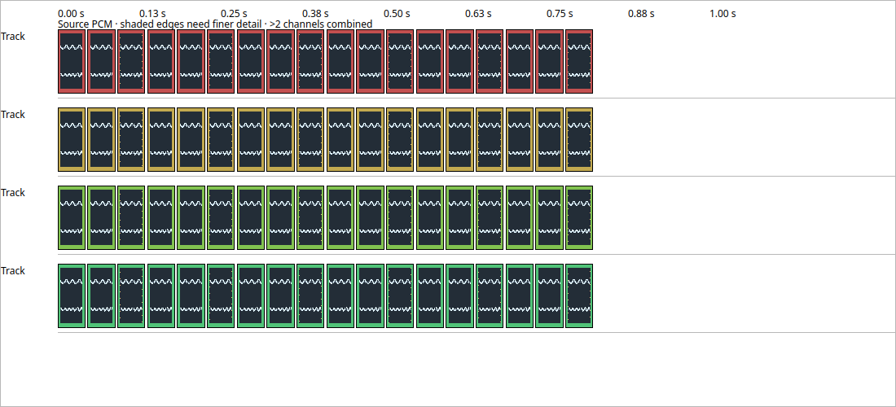

# Waveform overviews for dense sessions

Checkpoint 352 removes the timeline's small 32-visible-source allowance. The
overview now shares a fixed detail budget across its complete visible source set,
with capacity for up to 512 source records in the view's metadata allocation.
This is a viewport resource policy, not a limit on project tracks or assets.
Views exceeding the policy are explicitly refused; no subset is silently chosen.

For a visible source count `N`, preparation uses the next power-of-two count
bucket. Each source gets at most `min(65536, 1048576 / bucket)` base channel-bins,
split across its source channels. Power-of-two frame widths meet that allowance.
Thus dense views request coarser overviews before dispatch, with bounded total
base detail; workers never silently reduce a requested resolution after refusal.
The complete pyramid's actual charge is still checked by cache admission. The
timeline cache has a 48 MiB model allowance, with separate declared metadata and
child-process reservations. This is ownership accounting, not an RSS estimate.

The existing source identity, digest checks, full-view admission, generation
checks, one-child supervision and explicit retry semantics remain. Source peaks
and crop-edge shading retain their earlier meaning. A translated tooltip explains
that dense views use coarser overview detail. Catalog refresh adds one source key;
it does not qualify additional languages.

An unchanged view now polls prepared results without reconstructing keys and
rescanning project assets on every timer tick. View changes still rebuild and
validate the full requested set. Painting continues to read immutable prepared
data, with no media I/O or worker launch in the paint callback.

## Acceptance

The actual rendered TimelineView test creates 72 independent source files arranged
as four rows of 18 clips. All 72 sources must finish preparation, and every clip
must contain painted source peaks. A still view retains all prepared data and
does not increase the recorded reservation high-water mark. Separate checks
refuse a 513-record request and insufficient metadata credit without publishing
partial source data. Existing retry, stale-source/root replacement, shutdown,
channel selection and malformed-channel checks remain.

Both Release and ASan/UBSan with leak detection pass this fixture. Peak declared
reservation is **193,354,080 bytes**, within the fixture's 256 MiB ledger. The
sanitizer run passes 88 rendered-view assertions in 13.87 seconds; the Release
capture adds one screenshot-save assertion. The image was visually inspected.
This verifies the 72-source workflow, not every possible 512-source combination.

The full-window fixture also passes its 164 checks. Cache/controller and catalog
checks pass. After refreshing the existing timeline test executable against the
new library, both editing and virtualization tests pass in 7.91 seconds, including
62 virtualized-view checks. The earlier run of those two cached executables is
retained but is not used as evidence for this library change. The other six suites
were already built against their applicable current sources.

See the [acceptance manifest](../tests/results/M2/2026-10-15-dense-waveforms/manifest.json)
for tested source, commands, build identities, original logs and screenshot.

## Native preview and remaining work

The preceding frozen preview `f2f9f7c` now passes all 26 native Windows desktop
tests, including 164 full-window waveform and 10 rendered-view assertions. Its
deployment collection also succeeds with no dependency mismatches, confirming
the waveform-helper staging repair. Full original job `116708172956` from run
`38818238344` is retained. Collection does not qualify an installer. The overall
run is still active at this checkpoint and must finish before PR advancement.

This dense-view change is newer than that run and still needs native Windows
validation. Installed Linux remains the qualified `f2f9f7c` preview; Windows
remains the previous `97e9ecd` installation pending its matching preview workflow.
Fine-window decoding, files beyond the current source policy, larger viewport
policies, sustained hardware work, and the full DAW parity/localization scope
remain open. No binary release or VM test is performed here.
