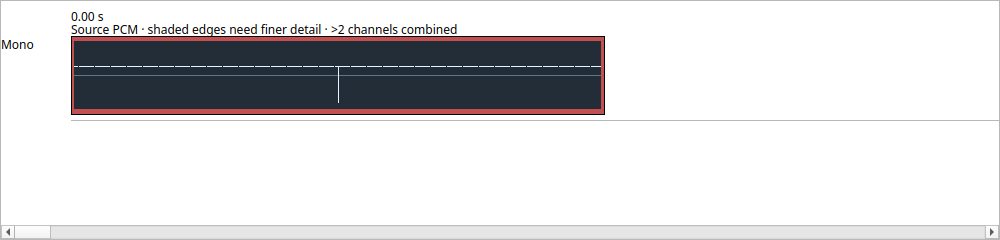

# Source-window waveforms for cropped and zoomed views

Checkpoint 356 adds source-frame windows to waveform preparation and connects
them to the timeline viewport. A short crop of a long recording can retain finer
detail without allocating a full-source pyramid at that resolution. This changes
display data only; audio processing and project state are unchanged.

## Data and process contracts

`WaveformWindow` identifies a first source frame and frame count. The default
`{0, UINT64_MAX}` requests the whole source. Explicit windows, including empty
windows at the end, are validated using subtraction before endpoint addition.
Pyramid bins begin at the window origin; their reported source ranges remain
absolute. Partial final bins contain only actual source samples.

The worker still decodes and validates the **entire pinned source**, including
finiteness, expected format and SHA-256. Only the requested window contributes
retained extrema. A nonfinite sample outside the window, a changed source digest,
or cancellation after the retained region still rejects the result. This retains
the existing validation guarantee; it is not a random-access decoding speedup.

Worker IPC advances to `SCWAVE02`, with a 172-byte header binding both window
coordinates in addition to source identity, operation, epoch, generation and PID.
The strict command schema adds `--window-first` and `--window-frames`. Parent and
child must be deployed together. Old or mismatched replies fail closed; this
private IPC change does not change saved projects or their migration policy.

Window coordinates participate in cache identity and result freshness. Different
windows of the same file cannot share a result accidentally. The parent computes
the exact admitted reply/model size from trusted request geometry before reading
the child reply. Existing child supervision, deadline, cancellation, resource
credit and normal-exit checks remain.

## Timeline behavior

The timer maps each visible clip interval into source sample coordinates using
the same rational source-time map as playback. Visible intervals sharing a source
are combined into one enclosing window. Existing source-count buckets divide the
detail allowance across the complete visible set; resolution is selected before
dispatch. A view beyond the declared resource policy is still refused as a whole.

Painting reads prepared data only. Coarser bins cover the interior, with already
prepared base bins filling the two crop edges. It never uses extrema from outside
the requested interval. Remaining edges without sufficiently fine base data stay
shaded. Additional edge work is bounded by the retained base channel-bin count.
Changing display channel reuses the prepared multichannel data.

## Acceptance

The focused Release suites pass for source pyramids, reply protocol, isolated
worker workflows, controller lifecycle, cache/projection, and the actual rendered
timeline. Independent oracles scan original sample arrays and construct expected
wire bytes without using the production encoder or pyramid reducer. Cases include
empty/interior/tail windows, malformed and overflowing ranges, 1–1024 source
channels, float headroom, stale-window rejection, cancellation after the window,
and nonfinite samples outside it.

The rendered fixture crops 1,000 frames from a 262,144-frame source at source
frame 120,001. A loud sample immediately before the crop must not appear. A
single-sample negative event inside the crop must remain visible. The captured
view was visually inspected. The existing 72-independent-source dense-view test
also passes within its 256 MiB declared ledger.

The final Release run passes all nine suites in 19.82 seconds, including 164
full-window checks, 204 timeline/selection checks, and GUI resource accounting.
The six focused ASan/UBSan suites pass in 22.45 seconds with leak detection and
halt-on-error enabled. The real isolated worker passes 117 cases. The dense-view
peak declared reservation is 183,701,472 bytes; this is ownership accounting,
not measured RSS. These results bind source commit `5c63f9e`.

See the [acceptance manifest](../tests/results/M2/2026-10-15-waveform-source-windows/manifest.json)
for original logs, code overlay, executable hashes and the rendered fixture.
Native Windows execution and installed-preview delivery of this change remain
separate gates. The installed previews remain on their preceding qualified source.

## Remaining work

Each uncached window currently incurs full-source validation. Nearby window reuse,
verified persistent peak storage or an equally strong bounded random-access
design can reduce that cost. Distant visible clips sharing a source use an
enclosing window, which can still require coarse detail between them. The current
source-size and viewport metadata policies remain; this change does not establish
unbounded file size, sample editing, processed-output waveforms or full DAW parity.
All other suite milestones and language qualification remain open.
